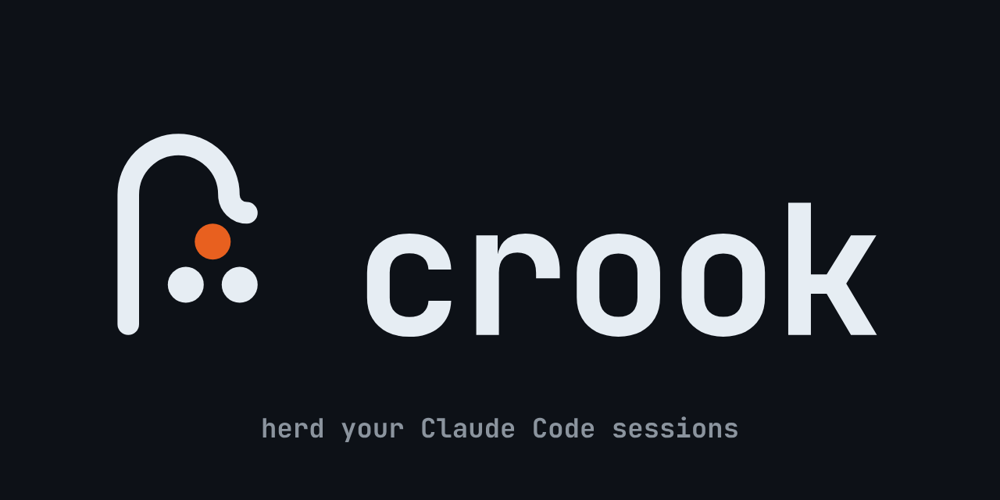
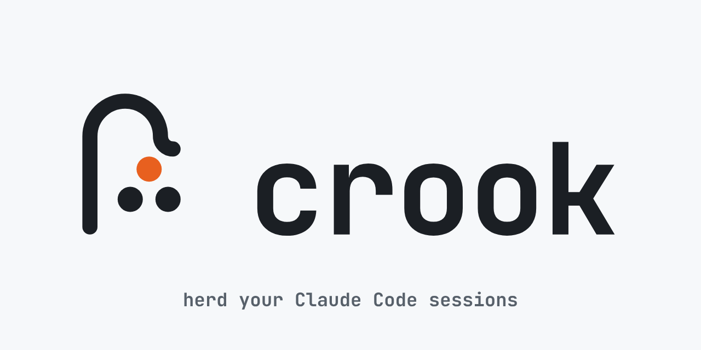

# crook logo

**The flock.** A shepherd's crook watching over three sessions. The orange one is the session that's waiting on you.

The logo was made with AI image generation, then cleaned up by hand.

Fixed-ink files only read well on a matching background, and the mono files draw black in a
browser, so some previews below look faint in the other scheme.

| Preview | File | Use |
|---|---|---|
|  | `crook-icon.svg` | Icon, 32 px and up. Switches ink colour with the viewer's light/dark scheme |
|  | `crook-icon-light.svg` | Icon, fixed ink for light backgrounds |
|  | `crook-icon-dark.svg` | Icon, fixed ink for dark backgrounds |
|  | `crook-icon-mono.svg` | Icon, single colour (`currentColor`, accent included), for one-ink contexts |
|  | `crook-icon-16.svg` | 16 px version, redrawn on the pixel grid (2 px strokes, no tip flick) |
|  | `crook-icon-16-light.svg` | 16 px, light backgrounds |
|  | `crook-icon-16-dark.svg` | 16 px, dark backgrounds |
|  | `crook-icon-16-mono.svg` | 16 px, single colour |
|  | `favicon.svg` | Same as `crook-icon-16.svg` |
|  | `favicon.ico` | 16 px (pixel-grid version), 32 px and 48 px |
|  | `crook-icon-512-light.png` | 512 px PNG, light backgrounds |
|  | `crook-icon-512-dark.png` | 512 px PNG, dark backgrounds |
|  | `crook-lockup.svg` | Icon plus the "crook" wordmark (JetBrains Mono Bold, outlined). Switches with the scheme |
|  | `crook-lockup-light.svg` | Lockup, light backgrounds |
|  | `crook-lockup-dark.svg` | Lockup, dark backgrounds |
|  | `crook-lockup-mono.svg` | Lockup, single colour |
|  | `crook-social-dark.png` | GitHub social preview, 1280×640 |
|  | `crook-social-light.png` | Social preview, light variant |
|  | `crook-social-dark.svg` | Source for the dark social preview |
|  | `crook-social-light.svg` | Source for the light social preview |
|  | `concepts/B-flock.svg` | The original concept this logo grew from |

## Colours

| Token | Hex | Notes |
|---|---|---|
| crook orange (accent) | `#E8601F` | 3.4:1 contrast on white, 5.5:1 on `#0D1117` |
| ink, light backgrounds | `#1B1F24` | |
| ink, dark backgrounds | `#E6EDF3` | |

Use the accent only on the waiting sheep. Don't recolour the crook.

## README header

```html
<picture>
  <source media="(prefers-color-scheme: dark)" srcset="assets/logo/crook-lockup-dark.svg">
  
</picture>
```
